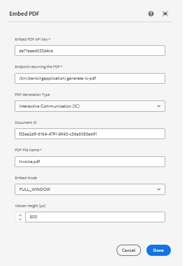
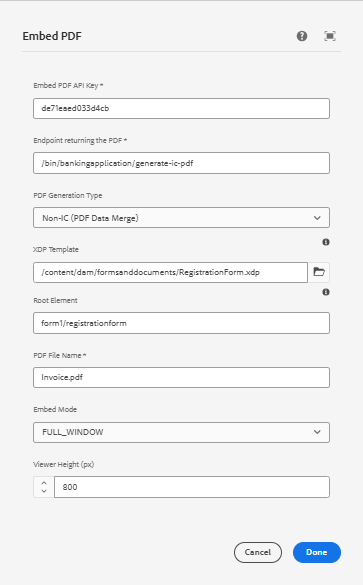
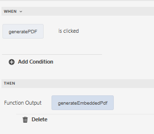

# Using the Embed PDF Component on an AEM Page


After deploying the Embed PDF component and its supporting services, you can configure it to display PDFs generated using data captured through an Adaptive Form.

The Embed PDF component is a standard AEM component and is not specific to Adaptive Forms. However, in this sample implementation, **the data used for PDF generation is always captured through Adaptive Form fields**.

The component can be placed in either of the following locations:

- **AEM Sites page:** Add the Embed PDF component to a Sites page that contains an Adaptive Form.
- **Adaptive Form:** Add the Embed PDF component within the Adaptive Form itself, provided the form's editor and template support the custom component.

In both scenarios, the Adaptive Form captures the data, and the Embed PDF component displays the generated PDF.

## Step 1: Add the Embed PDF Component

1. Open the AEM page or Adaptive Form in the appropriate editor.
2. Locate the **Embed PDF** component under the **AEM Forms PDF Embed** component group.
3. Add the component to the location where the generated PDF should appear.
4. Open the component's configuration dialog.

If the component is unavailable, verify that it is enabled in the relevant template or component policy.

>[!NOTE]
>
>The current implementation supports one Embed PDF component per page.

## Step 2: Configure the Embed PDF Component

Configure the component according to the PDF-generation service you want to use.

| Property | Description |
|---|---|
| Adobe PDF Embed API Client ID | Client ID used to initialize the Adobe PDF Embed API |
| PDF Generation Endpoint | AEM servlet endpoint that generates and returns the PDF |
| PDF Generation Type | Interactive Communication (IC) or PDF Data Merge |
| IC Document ID | Document ID of the Interactive Communication |
| XDP Template | XDP template used for PDF Data Merge |
| XML Root Element | XML hierarchy expected by the XDP template |
| PDF File Name | Filename assigned to the generated PDF |
| Embed Mode | PDF viewer display mode |
| Viewer Height | Height of the PDF viewer in pixels |

For Interactive Communications, configure the endpoint:


```text
/bin/aem-forms-pdf-embed/generate-ic-pdf
```

For PDF Data Merge, configure:


```text
/bin/aem-forms-pdf-embed/merge-pdf
```

These paths assume that the supporting servlets have been deployed using the paths supplied in the GitHub sample.


## Step 3: Capture Data Using Adaptive Form Fields

Create an Adaptive Form containing the fields required by your document-generation service.

For example, an Interactive Communication might require a `userId` or `email` parameter to retrieve data through its configured Form Data Model.

The Adaptive Form captures the values entered by the user.

The Embed PDF component does not read individual Adaptive Form fields directly. Instead, a custom function retrieves the form data using GuideBridge and passes it to the component.

## Step 4: Configure the Generate PDF Button

Add a button labeled **Generate PDF** to the Adaptive Form.

Configure the button's Click event to invoke the custom function `generateEmbeddedPdf()`.

The custom function retrieves the Adaptive Form data:

```javascript
window.guideBridge.getFormDataObject({
  success: function(resultObj) {
    const formData = JSON.parse(resultObj.data.data);

    window.renderEmbeddedPdf({
      formData
    });
  },
  error: function(error) {
    console.error("Unable to retrieve Adaptive Form data", error);
  }
});
```

The complete custom function is available in the GitHub repository:

`examples/adaptive-forms/generate-embedded-pdf.js`

The function performs two operations:

1. Retrieves the Adaptive Form field values using GuideBridge.
2. Invokes `window.renderEmbeddedPdf()` to initiate PDF generation and display.

The custom function does not call the PDF-generation servlet directly.

## Step 5: How the Embed PDF Component Processes the Request

When `window.renderEmbeddedPdf()` is invoked, the component:

1. Reads the PDF-generation configuration specified in its authoring dialog.
2. Combines the configured document information with the Adaptive Form data.
3. Constructs the request payload for the selected generation type.
4. Sends a POST request to the configured AEM servlet endpoint.
5. Receives the generated PDF as a binary response.
6. Uses the Adobe PDF Embed API to display the PDF inline.

For Interactive Communications, the request includes the configured Document ID and the captured form data.

For PDF Data Merge, the request includes the configured XDP template, XML root element, and captured form data.

The supporting servlet performs the actual document generation.

## Step 6: Display the Generated PDF

When the user clicks **Generate PDF**, a loading indicator appears while the document is generated.

Once the servlet returns the PDF, the Embed PDF component initializes the Adobe PDF Embed API and displays the document inline.

The generated PDF appears in the location where the component was added, whether that is an AEM Sites page containing the Adaptive Form or a supported Adaptive Form layout.

**[Insert screenshot: Adaptive Form with Generate PDF button and embedded PDF preview]**

### Step 7: Verify the Integration

Preview or publish the page containing the Adaptive Form and Embed PDF component.

1. Enter test values in the Adaptive Form fields.
2. Click **Generate PDF**.
3. Verify that the loading indicator appears.
4. Confirm that the PDF is generated and displayed inline.
5. Check the browser Network tab to verify that the configured PDF-generation endpoint returns HTTP `200` with `Content-Type: application/pdf`.

If PDF generation fails, inspect the browser console and AEM logs to identify the error.

>[!NOTE]
>
>The PDF-generation endpoint must authorize access to the requested document and data. This is particularly important when the Adaptive Form is publicly accessible and the IC servlet uses server-side OAuth credentials.