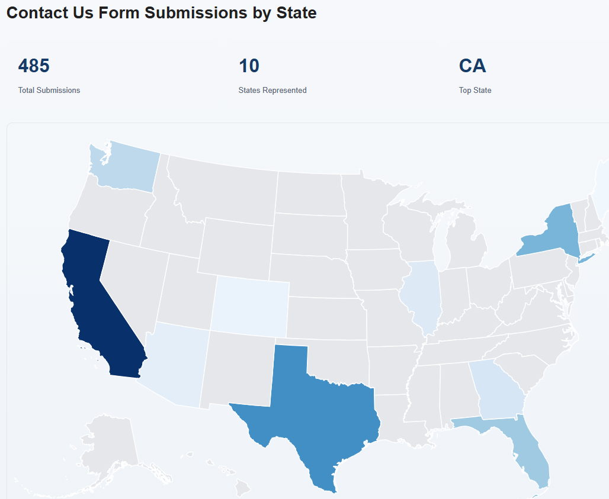

# Generic Interactive USA Data Map Component

## Overview

The **Generic Interactive USA Data Map** is a reusable Adobe Experience Manager (AEM) Sites component primarily designed to **visualize AEM Adaptive Form submissions by U.S. state**.



The component provides an interactive geographic representation of form submission activity, allowing users to understand the distribution of submissions across the United States, identify states with higher submission volumes, and view state-level submission counts.

Although its primary use case is displaying form submissions, the component is **datasource-independent** and can visualize other state-based business metrics, such as sales, customer distribution, and service requests.

Content authors can configure a compatible REST API endpoint through the AEM component dialog without modifying the component's JavaScript or backend implementation.

The component uses **D3.js and TopoJSON** to render an interactive USA map, dynamically coloring states according to values returned by the configured REST API.

## Key Features

- **Form Submission Visualization:** Displays aggregated AEM Adaptive Form submission counts by U.S. state.
- **Interactive Geographic Map:** Colors individual states according to submission volume.
- **State Selection:** Allows users to click a state to view its name, state code, and submission count.
- **Summary Statistics:** Displays total submissions, number of states represented, and the state with the highest submission volume.
- **Configurable REST Datasource:** Supports compatible REST APIs hosted on Azure, Render, AWS, or other platforms.
- **Datasource Independence:** Does not require a specific database or backend technology.
- **Configurable JSON Field Mapping:** Allows authors to specify the JSON properties representing state codes and numeric values.
- **Customizable Presentation:** Supports configurable map titles, metric labels, summary statistics, and tooltips.
- **Responsive Design:** Adapts to different screen sizes.
- **Keyboard Accessibility:** Supports keyboard-based state selection.

## Primary Use Case — AEM Forms Submissions by State

The component is generally used as part of an **AEM Forms Dashboard** to visualize the geographic distribution of Adaptive Form submissions.

When a user submits an Adaptive Form, the submission data is stored in a backend system such as Azure SQL Database.

A REST API retrieves and aggregates the submissions by state and returns the results in the JSON format expected by the component.

The USA Map consumes this API response and displays the submission counts geographically.

### Example

If an organization receives submissions from California, Texas, and New York, the map highlights those states according to the number of submissions received.

Users can interact with the map to view the submission count associated with each state.

This provides a visual way to monitor form submission activity and identify geographic trends.

## REST API Data Contract

The component expects an HTTP GET endpoint returning aggregated state-level data in JSON format.

**Example response:**

```json
{
  "states": [
    { "state": "CA", "count": 150 },
    { "state": "TX", "count": 95 },
    { "state": "NY", "count": 70 }
  ]
}
```

Each record represents a U.S. state and its corresponding submission count.

The names of the state and value fields are configurable through the AEM authoring dialog.

For example, a REST API returning `stateCode` and `totalSubmissions` can be supported by mapping those fields in the component configuration.

**The backend REST API is responsible for retrieving, aggregating, and formatting the form submission data into the expected state-level JSON structure.** The component does not query databases or aggregate individual submissions.

## AEM Authoring Configuration

The component provides an AEM Touch UI dialog with the following configuration options:

| Configuration | Description |
|---|---|
| Map Title | Heading displayed above the USA map |
| Metric Label | Label describing the displayed metric, such as Submissions |
| Data Source Type | Type of configured JSON datasource |
| REST API Endpoint | URL returning aggregated state-level data |
| State Field | JSON property containing the two-letter state code |
| Value Field | JSON property containing the submission count |
| Show Summary Statistics | Enables or disables summary statistics |
| Show Tooltips | Enables or disables state tooltips |
| Security Settings | Describes the intended public or authenticated data-access mode |

Security configuration fields do not independently enforce access control. Protected endpoints must implement their own authentication and authorization.

## Datasource Integration

The component supports two REST integration patterns.

### Direct REST API Integration

The component directly calls a compatible REST API from the browser.

The endpoint must support HTTPS, appropriate CORS configuration, and any applicable Content Security Policy requirements.

### Protected REST API Integration

For backend services requiring API keys or authentication, the component can call an AEM Sling Servlet or another secure backend proxy.

This ensures sensitive credentials remain server-side.

## Validated Implementations

### AEM Forms Submission Dashboard

The component has been implemented to display Adaptive Form submission counts stored in Azure SQL Database.

The integration uses AEM Adaptive Forms, Azure Functions, Azure SQL, and an AEM Sling Servlet to retrieve state-level submission counts.

### External REST API Integration

The component has also been tested with a Node.js REST API hosted on Render, returning sample sales data by U.S. state.

This demonstrates that the component can visualize data from different backend systems without requiring changes to its rendering logic.

## Technology Stack

- Adobe Experience Manager as a Cloud Service
- AEM HTL and Granite UI
- JavaScript and SCSS
- D3.js and TopoJSON
- Webpack and AEM Client Libraries
- JSON REST APIs

## Reusability

While the component is primarily intended for visualizing **AEM Forms submissions by state**, it can also display other state-level metrics, including sales, customer distribution, marketing conversions, service requests, and branch activity.

To reuse the component, authors configure a compatible REST endpoint and the appropriate JSON field mappings.

## Summary

The **Generic Interactive USA Data Map** provides a reusable geographic visualization capability for AEM Sites, with **AEM Adaptive Form submission monitoring as its primary use case**.

It enables organizations to visualize form submission volumes across U.S. states, identify geographic trends, and interactively explore state-level submission counts.

Its datasource-independent architecture also makes it suitable for other business reporting scenarios, provided the configured REST API returns compatible state-level JSON data.