# Configure OpenTelemetry for insights into AEM applications

Learn how to connect an AEM as a Cloud Service environment to the [OpenTelemetry](https://opentelemetry.io/) compatible observability platform of your choice. 

This tutorial uses the [AEM WKND sample project](https://github.com/adobe/aem-guides-wknd) as the example application and shows how to export telemetry by deploying `config/otel.yaml` using a Cloud Manager Config Pipeline.

The high-level steps are:

1. Obtain the OTLP/HTTPS endpoint and ingestion credential for _your observability platform_.
2. Store the credential securely in Cloud Manager.
3. Add the `config/otel.yaml` file to your AEM project repository.
4. Run the Cloud Manager Config Pipeline.
5. Generate WKND or your application traffic.
6. Verify the telemetry in your observability platform.

## Prerequisites

Before starting, ensure that you have:

- An **AEM as a Cloud Service** development, stage, or production environment with the WKND site or your own application deployed. OpenTelemetry is not supported on Sandbox programs or Rapid Development Environments (RDEs).
- Access to **Cloud Manager** with permission to manage environment variables and to create and run a Config Pipeline.
- An observability platform that accepts **OTLP over HTTPS**, with an endpoint and an ingestion credential.
- Access to the observability platform to verify and visualize the incoming AEM telemetry.

## Step 1: Obtain your observability endpoint and credential

In your observability platform, locate its **OTLP/HTTPS ingestion endpoint** and create or retrieve the appropriate ingestion credential. See your platform's documentation for instructions.

This tutorial uses a self-hosted observability platform that supports OTLP over HTTPS and requires a basic authentication token.

## Step 2: Store your observability credential in Cloud Manager

Store the ingestion credential as a Cloud Manager **secret environment variable**.

1. In [Adobe Cloud Manager](https://my.cloudmanager.adobe.com/), select your AEM program.
   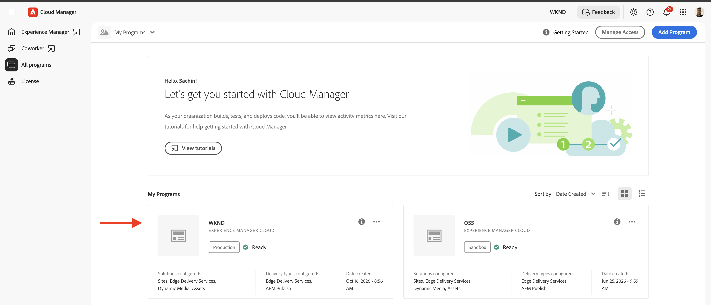

2. Select the target environment and click **View Details**.
   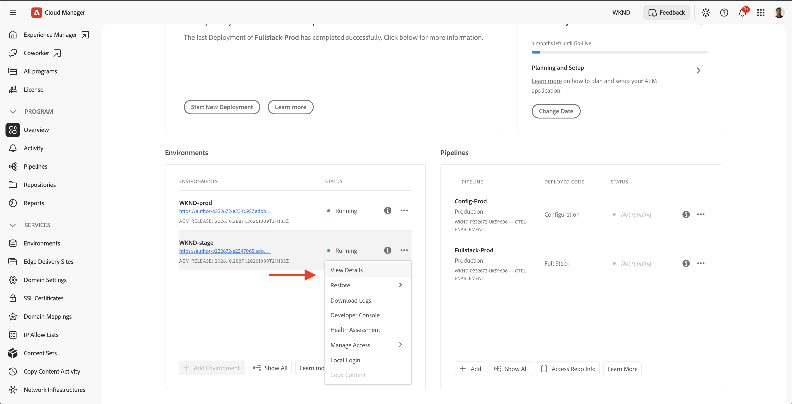
   
3. On the **Configuration** tab, click **Add/Update** and add an environment variable with these values:
   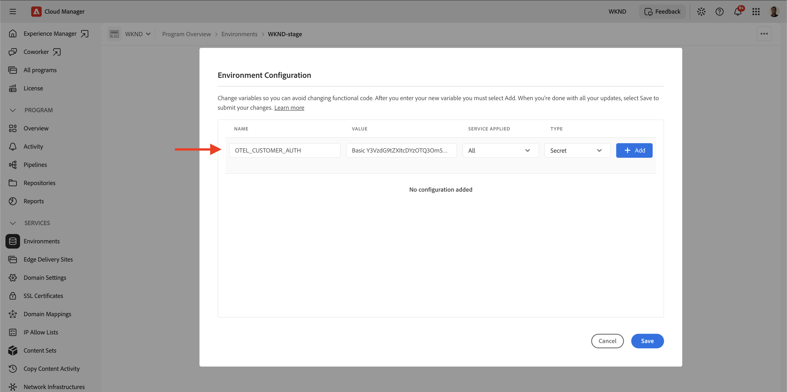

   | Setting | Value |
   | --- | --- |
   | Name | `OTEL_CUSTOMER_AUTH` |
   | Value | Your provider's ingestion credential. The format varies by platform. See the [provider-specific settings](https://experienceleague.adobe.com/en/docs/experience-manager-cloud-service/content/implementing/developing/opentelemetry-apm-integration#configure-credential) for examples. |
   | Service applied | **All** |
   | Type | **Secret** |

   In this example, the self-hosted platform uses a basic authentication token in the `Basic <base64(user:password)>` format.

4. Click **Add** and then **Save** to store the environment variable.
   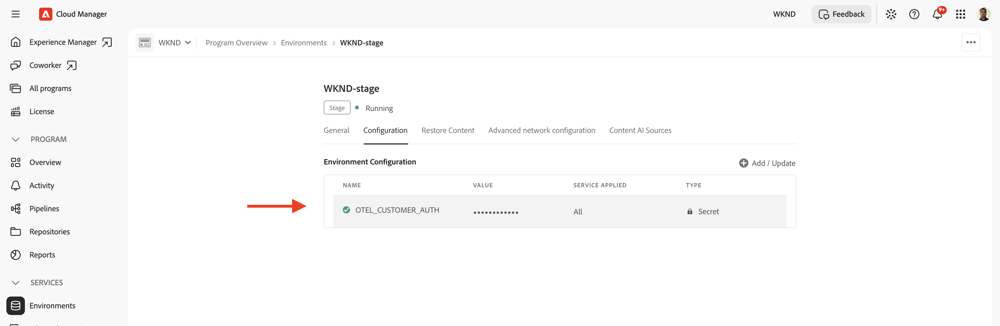

The `config/otel.yaml` file references this secret as `${{secrets.OTEL_CUSTOMER_AUTH}}`. The credential must never appear in the AEM repository or the pipeline logs.

## Step 3: Add OpenTelemetry configuration

In your AEM project repository, create the `config/otel.yaml` file. The self-hosted platform in this tutorial uses the following configuration:

```yaml
kind: "Otel"
version: "v1"
metadata:
  envTypes:
    - "dev"
    - "stage"
    - "prod"
data:
  enabled: true
  type: "generic"
  endpoint: "https://my-self-hosted-observability.adobe.net"
  authHeaderName: "Authorization"
  authHeaderValue: "${{secrets.OTEL_CUSTOMER_AUTH}}"
  metrics: true
  logs: true
```

The key settings are:

| Setting | Purpose |
| --- | --- |
| `metadata.envTypes` | Environment types to which the configuration applies. Include the target environment type. |
| `enabled` | Enables customer telemetry export when set to `true`. |
| `type` | Selects the destination configuration, for example `generic` for a self-hosted platform. |
| `endpoint` | Base OTLP/HTTPS URL for the destination. |
| `authHeaderName` | HTTP header that carries the credential, for example `Authorization`. |
| `authHeaderValue` | Reference to the Cloud Manager secret, not the credential itself. |
| `metrics` | Enables metrics export when `true`. |
| `logs` | Enables application log export when `true`. |

Traces export whenever the integration is enabled. Metrics and logs are optional. They export only when set to `true`.

For example, see the following WKND sample configuration:

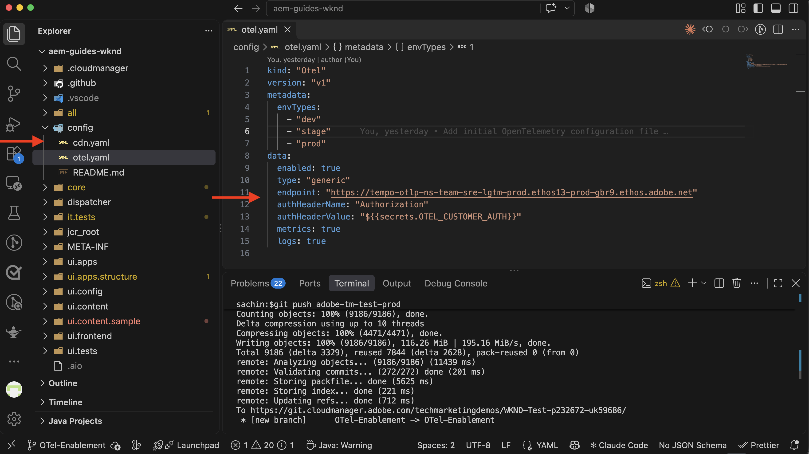

## Step 4: Deploy OpenTelemetry configuration

1. Commit the `config/otel.yaml` file and push it to the repository and branch that your Config Pipeline uses as its source.
2. In Cloud Manager, create or edit the **Config Pipeline** for the environment, and verify its details.
    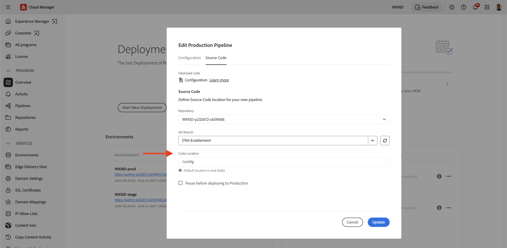
3. Select the pipeline name and click **Run**.
    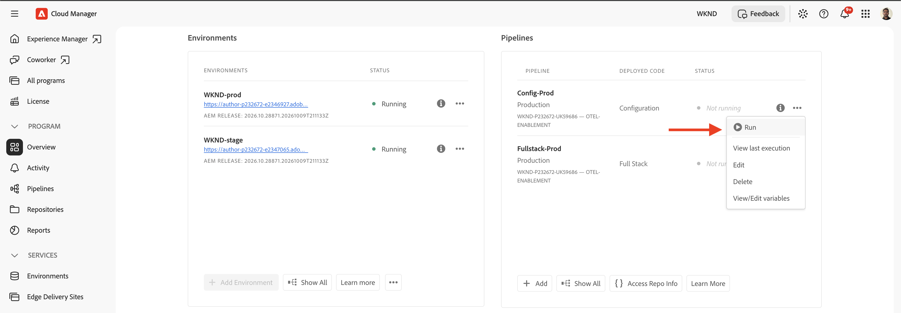
4. Monitor the pipeline run until it completes successfully.
   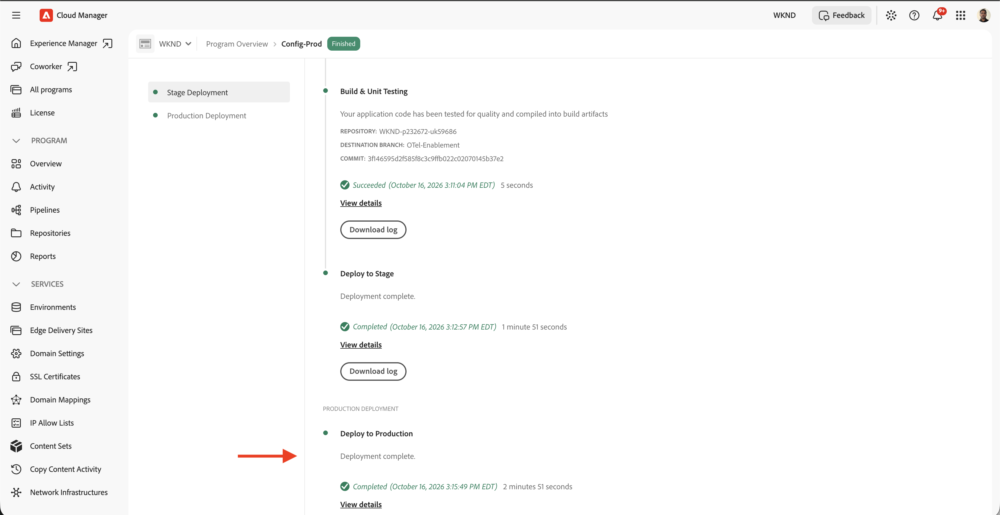

The pipeline validates the configuration before it applies the destination settings.

## Step 5: Generate AEM traffic

After the pipeline completes, generate some application activity:

1. Open the WKND site or your application on the AEM Publish service and navigate between a few pages.
2. Optionally, open the WKND site on the Author service to generate Author telemetry.

Wait a few minutes for the telemetry to reach your observability platform.

## Step 6: Verify telemetry in your observability platform

Open your observability platform and look for the telemetry. The steps to locate traces, metrics, and logs vary by platform.

### Find the AEM service

Search for an AEM service name similar to:

```text
cm-p<program>-e<environment>-aem-publish-<environment-type>
```

In the self-hosted platform used in this tutorial, the Publish service telemetry appears as follows:

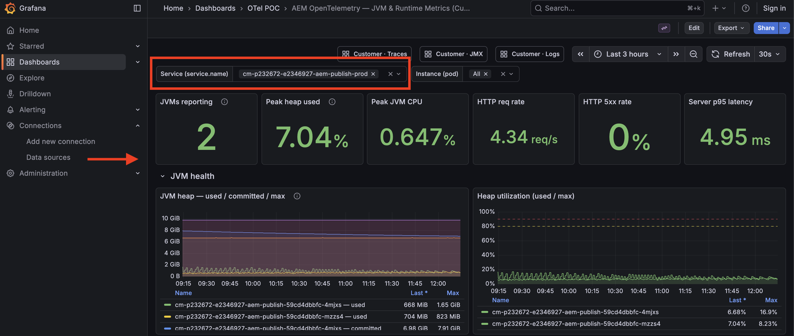

### Inspect traces

Look for inbound HTTP request spans that match your WKND page requests. Open a trace and review its request name, duration, and related spans.

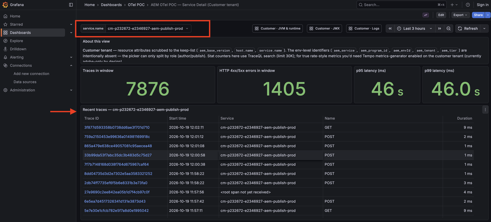

### Inspect metrics

Because the configuration sets `metrics: true`, look for JVM and HTTP metrics such as:

- `jvm.memory.used`
- `jvm.gc.duration`
- `jvm.thread.count`
- `http.server.request.duration`

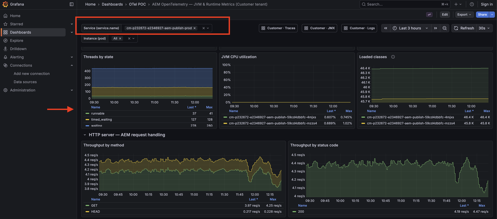

### Inspect logs

Because the configuration sets `logs: true`, check your destination for AEM application logs. The integration exports logs at a supported severity (`WARN` or higher) threshold, so ordinary page visits might not produce log entries at that level.

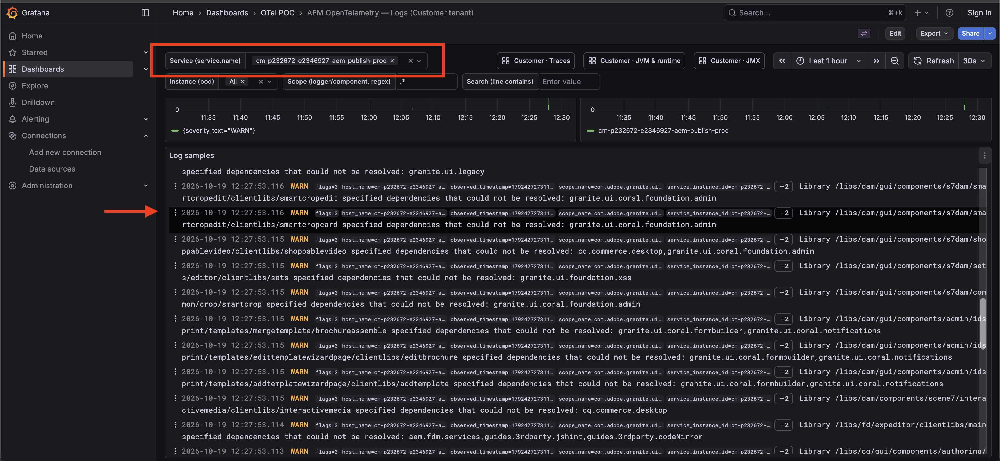

## Troubleshooting

If the Config Pipeline fails or telemetry does not appear in your observability platform, review the pipeline logs and check the following:

| Symptom | What to check |
| --- | --- |
| OpenTelemetry is not enabled for the environment | Confirm your AEM program is eligible for OpenTelemetry and that the feature is enabled for the target environment. Contact Adobe Support if access or platform enablement is required. |
| Configuration appears to be ignored | Confirm that `metadata.envTypes` includes the target environment type (`dev`, `stage`, or `prod`). A mismatch causes the configuration to be skipped without an error. |
| Secret reference error | Confirm that `OTEL_CUSTOMER_AUTH` exists as a Cloud Manager **secret environment variable**, with **Service applied** set to **All**. It must not be a pipeline variable. |
| Authentication failure (`401` or `403`) | Verify the credential and authentication header required by your provider. For example, New Relic requires an ingest License key, not a user API key. |
| Endpoint unreachable or credential validation fails | Verify the endpoint URL, region, and HTTPS connectivity. Private endpoints or destinations requiring a stable outbound IP address may require Advanced Networking to be provisioned and enabled. |
| Dynatrace OneAgent conflict | OpenTelemetry cannot be enabled while Dynatrace OneAgent is active on the environment. The existing integration must be removed before configuring OpenTelemetry. |
| Pipeline completes but no telemetry appears | Allow a few minutes for data to arrive, generate WKND or other relevant traffic, and check the provider's ingestion status and `service.name` filters. |
| No logs appear | Confirm `logs: true` is configured and that the AEM application has generated log entries at WARN level or above. |
| Duplicate log entries | Check whether OpenTelemetry log export and AEM Log Forwarding are sending logs to the same destination. |
| Internal system error | Retry the Config Pipeline. If the error persists, contact Adobe Support with the pipeline execution details. |

If the issue persists, contact Adobe Support and provide the AEM program ID, environment ID, Config Pipeline execution ID, exact error message, and observability provider details. **Never include authentication credentials or secret values.**

For additional configuration examples and troubleshooting information, see the [OpenTelemetry product documentation](https://experienceleague.adobe.com/en/docs/experience-manager-cloud-service/content/implementing/developing/opentelemetry-apm-integration).

## Next steps

You have configured OpenTelemetry for AEM as a Cloud Service and verified that telemetry from the WKND sample application is available in your observability platform.

You can now use this telemetry to investigate slow or failing requests, monitor JVM and HTTP performance, and correlate application logs with traces to better understand AEM application behavior.

To explore additional configuration options, supported observability providers, and networking requirements, refer to the [OpenTelemetry product documentation](https://experienceleague.adobe.com/en/docs/experience-manager-cloud-service/content/implementing/developing/opentelemetry-apm-integration).

## Additional resources

- [OpenTelemetry in AEM as a Cloud Service](https://experienceleague.adobe.com/en/docs/experience-manager-cloud-service/content/implementing/developing/opentelemetry-apm-integration)
- [AEM WKND sample project](https://github.com/adobe/aem-guides-wknd)
- [Configure Advanced Networking](https://experienceleague.adobe.com/en/docs/experience-manager-cloud-service/content/security/configuring-advanced-networking)
