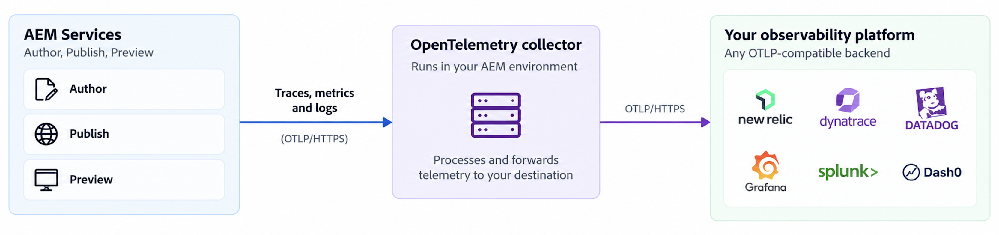

# Overview of Observability via OpenTelemetry in AEM as a Cloud Service

Learn how AEM as a Cloud Service uses OpenTelemetry to send traces, metrics, and logs to the Application Performance Monitoring (APM) platform of your choice.

Adobe is replacing the built-in Application Performance Monitoring (APM) integration in AEM as a Cloud Service with [OpenTelemetry](https://opentelemetry.io/), an open, vendor-neutral standard for collecting and exporting traces, metrics, and logs. With OpenTelemetry, you bring your own APM endpoint and monitor AEM alongside the rest of your applications, using the tools your teams already know. For more information, see the [OpenTelemetry documentation](https://experienceleague.adobe.com/en/docs/experience-manager-cloud-service/content/implementing/developing/opentelemetry-apm-integration).

This article explains what the integration provides, how telemetry flows from AEM to your APM platform, what you control, and what to consider before you enable it. 

>[!NOTE]
>
>The OpenTelemetry integration is currently available through a **Beta** program, with broader availability planned for later in 2026. To join, email [aemcs-apm-beta@adobe.com](mailto:aemcs-apm-beta@adobe.com) and describe your use case. If you rely on the built-in APM integration today, use the Beta period to evaluate OpenTelemetry and plan your transition.

## Why OpenTelemetry

With OpenTelemetry, you can:

- **Choose your platform**: Send telemetry to any backend that accepts OpenTelemetry Protocol over HTTPS (OTLP/HTTPS), including your current provider if it supports OTLP.
- **See the full picture**: Get traces, metrics, and logs through one integration, instead of separate mechanisms.
- **Investigate faster**: Find slow or failing requests, track JVM health over time, and correlate AEM behavior with your other services during an incident.
- **Stay in control**: Configure the destination yourself through the Cloud Manager Config Pipeline, and manage dashboards, alerts, and retention in your own platform.

Adobe provides and updates the OpenTelemetry Java agent that runs with AEM, so you do not install or upgrade it. You decide where the telemetry goes.

## How it works

The following diagram shows the logical flow of telemetry from AEM services to your observability platform:



The OpenTelemetry Java agent collects application telemetry from AEM services and sends it to an OpenTelemetry Collector running within the AEM environment. The collector processes the telemetry and forwards it over OTLP/HTTPS to your configured observability platform.

Only telemetry generated by your AEM application is sent. Information about the underlying runtime and platform, such as internal hostnames, addresses, container identifiers, and operating system or process details, is removed before any data leaves your environment.

## What telemetry is available

| Signal | What you get | How to enable |
| --- | --- | --- |
| **Traces** | Spans for the requests your application handles: inbound HTTP requests, servlet processing, and outbound calls. | Configure and deploy `otel.yaml` file using the Cloud Manager Config Pipeline. |
| **Metrics** | JVM runtime metrics (memory, garbage collection, threads, CPU utilization) and HTTP server request metrics (rate, latency, and error rate). | Configure and deploy `otel.yaml` file with `metrics: true` using the Cloud Manager Config Pipeline. |
| **Logs** | AEM application log entries, sent using the OpenTelemetry logs signal. | Configure and deploy `otel.yaml` file with `logs: true` using the Cloud Manager Config Pipeline. |

A few details to keep in mind:

- To keep traces focused on application requests, high-volume internal activity such as health probes and scheduler (Quartz) jobs is filtered out.
- Fine-grained AEM framework-internal spans, such as Sling resource resolution, OSGi services, and JCR access, are not emitted in this release.
- Metrics use standard OpenTelemetry names, for example `jvm.memory.used`, `jvm.gc.duration`, `jvm.thread.count`, and `http.server.request.duration`.

>[!WARNING]
>
>If you send logs through OpenTelemetry **and** through [Log Forwarding](https://experienceleague.adobe.com/en/docs/experience-manager-cloud-service/content/implementing/developing/logging) to the same destination, you receive duplicate log messages. Enable only one path per destination, or send each to a different destination.
>
>Log Forwarding is a separate mechanism and continues to work as it does today.

## How AEM services are identified

Every trace, metric, and log entry carries resource attributes that let your platform tell environments and tiers apart:

- `service.name` identifies the program, environment, tier, and environment type, following this pattern:

  ```text
  cm-p<program>-e<environment>-aem-<author|publish|preview>-<environment-type>
  ```

  For example, `cm-p12345-e67890-aem-publish-prod` is the Publish service of environment 67890 in program 12345, running in a production environment.

- `deployment.environment` identifies the environment type, such as `prod` or `stage`.

Use these attributes to filter and group telemetry, and to correlate logs with traces and metrics from the same service.

## What you control

You configure the integration by adding and deploying the `config/otel.yaml` file using the Cloud Manager Config Pipeline.

The sample configuration file is:

```yaml
kind: "Otel"
version: "v1"
metadata:
  envTypes:
    - "dev"
    - "stage"
    - "prod"
data:
  enabled: true
  type: "generic"
  endpoint: "<YOUR_OTLP_HTTPS_ENDPOINT>"
  authHeaderName: "Authorization"
  authHeaderValue: "${{secrets.OTEL_CUSTOMER_AUTH}}"
  metrics: true
  logs: true
  advancedNetworking: false
```

The configuration determines:

- The environment types (`prod`, `stage`, `dev`) it applies to
- The destination type (`newrelic`, `dynatrace`, `generic`, etc.) and OTLP/HTTPS endpoint
- Whether metrics (`metrics: true`) and logs (`logs: true`) are exported in addition to traces
- Whether Advanced Networking (`advancedNetworking: true`) is used for the destination
- The authentication credential (`authHeaderValue`), referenced as a secret

Store credentials as a Cloud Manager **secret** environment variable named `OTEL_CUSTOMER_AUTH`, and reference it from the configuration file. Never store credentials as plain text in the repository.

If your OTLP/HTTPS endpoint is private, or requires outbound traffic from a known, stable IP address, enable [Advanced Networking](https://experienceleague.adobe.com/en/docs/experience-manager-cloud-service/content/security/configuring-advanced-networking) with dedicated egress. The `advancedNetworking` setting has no effect unless Cloud Manager has already provisioned Advanced Networking for the environment. A public SaaS endpoint uses the standard outbound network path.

## Supported destinations

You can send telemetry to any APM platform that exposes an OTLP/HTTPS endpoint, including:

- New Relic
- Dynatrace
- Datadog
- Grafana Cloud
- Splunk Observability Cloud
- Dash0
- Honeycomb
- Elastic Observability
- Sumo Logic
- ServiceNow Cloud Observability

This list is not exhaustive. OpenTelemetry defines the telemetry format and export protocol; your selected platform determines how the data is queried, visualized, retained, and alerted on.

## Before you start

- **Environments**: You can enable OpenTelemetry on production, stage, and development environments, each individually. Sandbox programs and Rapid Development Environments (RDEs) are not supported.
- **Versions**: The integration supports OpenTelemetry Java agent 2.x and the OTLP/HTTPS export protocol.
- **Agent variants**: The upstream OpenTelemetry agent is the default and works with any APM platform. Grafana and Splunk variants add vendor-specific instrumentation and defaults for those platforms.

## Next steps

See how the AEM WKND sample project configures OpenTelemetry in the [configuration guide](./configure-opentelemetry.md).