# Protect pages with CDN OIDC authentication using Google as the identity provider

Learn how to protect a section of an Edge Delivery Services site with the Adobe-managed CDN OpenID Connect (OIDC) authenticator and Google as the identity provider.

>[!IMPORTANT]
>
>CDN OIDC authentication is a **beta** feature. To request access, email [aemcs-edgecompute-feedback@adobe.com](mailto:aemcs-edgecompute-feedback@adobe.com).

## What you build

In this tutorial, you add a members-only section, the [Frescopa Insiders Lounge](https://dev-myfrescopa.enablementadobe.com/dev/branches/oidc/members/welcome), to the demo [Frescopa](https://github.com/SachinMali/frescopa) Edge Delivery Services site served from `dev-myfrescopa.enablementadobe.com`.

Everything under `/members/` requires a Google sign-in. The rest of the site stays public.

| URL | Access | Purpose |
| --- | --- | --- |
| `/` and all other pages | Public | The regular Frescopa site |
| `/members/welcome` | Sign-in required | The Insiders Lounge, the page visitors see after login |
| `/signed-out` | Public | A short goodbye page shown after logout |
| `/login`, `/callback`, `/logout` | Handled by the Adobe-managed CDN | Start sign-in, receive the Google response, and end the session |

>[!NOTE]
>
>The table shows the paths as they appear on a production site. In this tutorial, the pages are authored in the `oidc` branch of the Dev site, so they are served under the `/dev/branches/oidc` prefix, for example `/dev/branches/oidc/members/welcome`. The CDN configuration in [Step 4](#step-4-configure-the-cdn-oidc-authenticator) accounts for this prefix.

### How it works

1. A visitor requests the protected `/members/welcome` page.
1. The CDN rule matches the `/members/` path and finds no valid session using the `_aem_oidc_session_token` cookie, so it redirects the visitor to Google to sign in.
1. After sign-in, Google sends the visitor back to the Adobe-managed CDN `callback` URL. The CDN verifies the returned token against Google's public keys (`jwksUri`) and `issuer`. It then creates a session and sets the `_aem_oidc_session_token` cookie for subsequent requests.
1. The CDN serves the requested `/members/welcome` page to the visitor, now that a valid session exists.

The sign-in is enforced at the Adobe-managed CDN only. The same content is also reachable on the `.aem.live` hostname, so restrict access there as well to ensure that only authenticated visitors can reach your content. See [Step 6: Restrict access to the `.aem.live` origin](#step-6-restrict-access-to-the-aemlive-origin).

## Prerequisites

To follow this tutorial, you need to have the following prerequisites in place:

- Your program is enrolled in the CDN OIDC authentication beta.
- The Frescopa site (or your own Edge Delivery Services site) is set up in Cloud Manager and served from a custom domain on the Adobe-managed CDN. See **Step 1: Onboard your Edge Delivery site to Cloud Manager** of [Set up AEM Edge Functions on Edge Delivery Services](../../../cloud-service/edge-functions/setup-eds.md).
- A Cloud Manager Edge Delivery configuration pipeline exists, and you can edit its variables. See [Edge Delivery configuration pipeline](../developing/cloud-manager-configuration-pipeline.md).
- A Git repository connected to the pipeline that contains a `config/` folder (the pipeline in this tutorial reads `config/cdn.yaml`).
- A Google account that can create projects in [Google Cloud Console](https://console.cloud.google.com/).
- Access to the Frescopa content source to author and publish a page.

## Step 1: Create the members-only content

First, create the section or pages that the sign-in protects. For demonstration purposes, this tutorial uses a single members-only page called `welcome` under the `members` section.

1. Follow the [branches page pattern](../developing/universal-editor/6-author-block.md#open-universal-editor-using-code-from-the-teaser-branch) to create the `members` section and the `welcome` page within it. For example, the resulting path is `/content/frescopa/en/dev/branches/oidc/members/welcome`.
    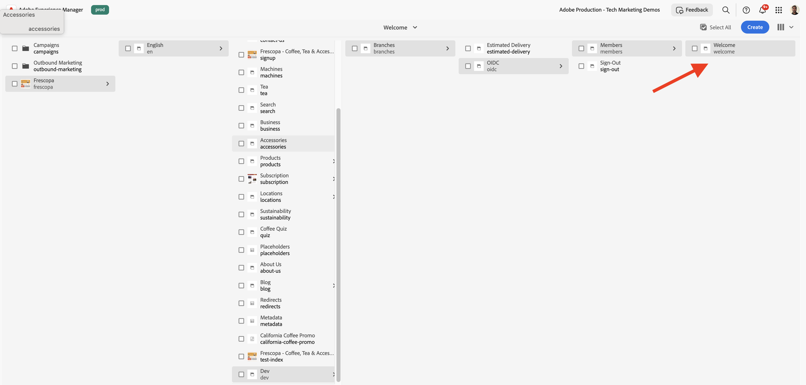
1. Author the `welcome` page with the following content:

    | Section | Content |
    | --- | --- |
    | Hero | Heading: _Welcome to the Frescopa Insiders Lounge_. Text: _Early access to small-batch roasts, brewing masterclasses, and members-only offers._ |
    | Cards (3) | _Roaster's Reserve_ (this month's limited lot with tasting notes), _Brew like a barista_ (a guide to dialing in espresso at home), _Insiders offers_ (a members-only discount code) |
    | Default content | A line telling visitors how to leave: _Done for the day? Sign out_. The _Sign out_ should point to `/logout` URI to trigger the sign-out process. |

    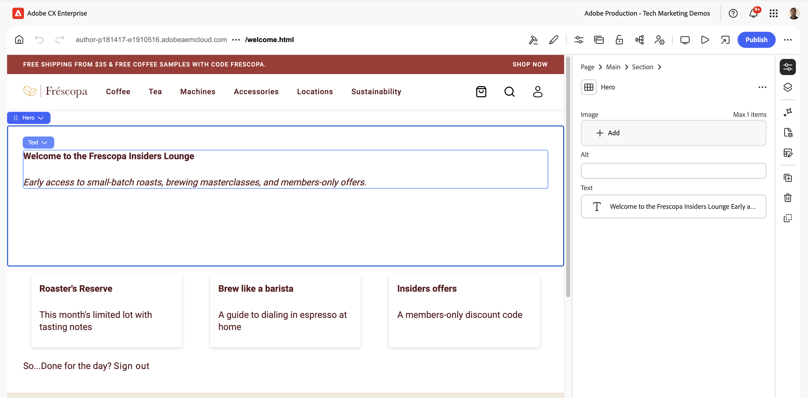

1. Create a public page called `signed-out` as a sibling of the `members` section, with a short message such as _You have been signed out of the Frescopa Insiders Lounge_ and a link back to the home page.

    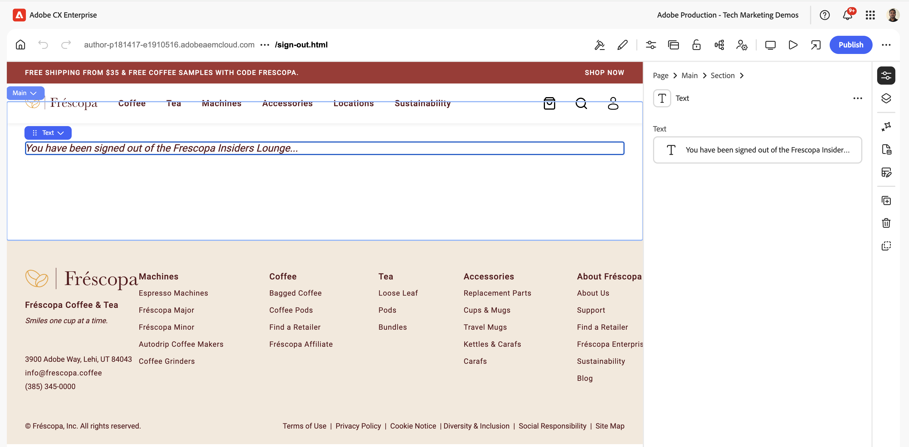

1. Preview both pages and publish them.

>[!TIP]
>
>Do not place the `signed-out` page under the `/members/` section. Otherwise, the visitor is redirected back to the Google sign-in immediately after signing out.

At this point, `/members/welcome` is **still publicly reachable**. You protect it in the following steps.

## Step 2: Create the Google OAuth client

For this setup, Google acts as the IdP. You need to create an OAuth client in the Google Cloud Console so that Google knows about your web application and where to send visitors after they sign in.

1. In [Google Cloud Console](https://console.cloud.google.com/), select or create a project, for example `frescopa-insiders`.
    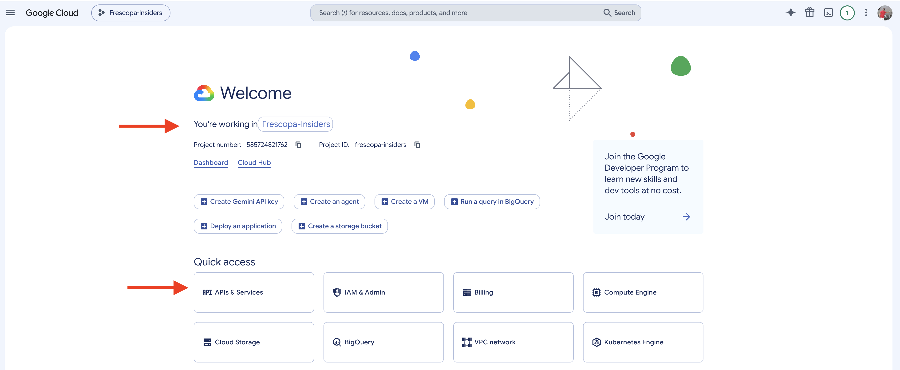
1. Open **APIs & Services** > **OAuth consent screen** and configure the consent screen:
    1. Set the **App name** to `Frescopa Insiders Lounge` and add your support email.
    1. Select the **User Type**, either **Internal** (Google Workspace only) or **External**, according to your use case. This tutorial uses **External**.
    1. Keep the default scopes (`openid`, `email`, `profile`).
1. Open **Credentials** > **Create credentials** > **OAuth client ID**.
    1. Set **Application type** to **Web application** and **Name** to `Frescopa Members Only`.
    1. Under **Authorized redirect URIs**, add the CDN callback URL: `https://dev-myfrescopa.enablementadobe.com/callback`.

    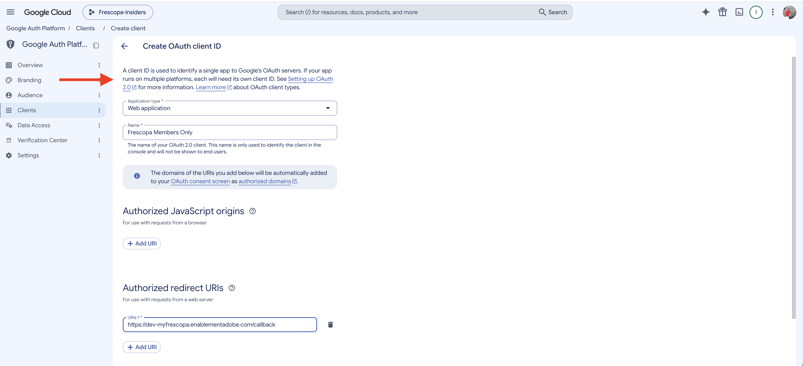

1. Select **Create** and copy the **Client ID** and **Client secret**. You use them in the next steps.

    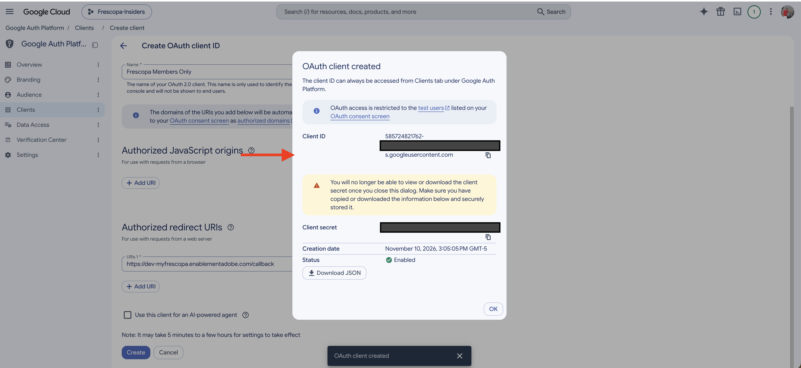

>[!IMPORTANT]
>
>The redirect URI must match the CDN `callback` setting exactly, including the scheme, domain, and path. In this tutorial, it is `https://dev-myfrescopa.enablementadobe.com/callback`. Use the domain of your own environment.

>[!IMPORTANT]
>
>**Who can sign in is decided at Google, not at the CDN.** The CDN verifies that the visitor signed in successfully, and the documented configuration has no allow-list. Use the consent screen to limit access:
>
>- **Internal** (Google Workspace only): only users in your Workspace organization can sign in.
>- **External** in _Testing_ status: only the test users you list can sign in.
>- **External** in _In production_ status: any Google account can sign in. This suits identifying visitors, not restricting them.

### Google endpoints used in the CDN configuration

Google publishes these values in its [OpenID Connect discovery document](https://accounts.google.com/.well-known/openid-configuration). Use them in Step 4.

| CDN setting | Google value |
| --- | --- |
| `authEndpoint` | `https://accounts.google.com/o/oauth2/v2/auth` |
| `tokenEndpoint` | `https://oauth2.googleapis.com/token` |
| `jwksUri` | `https://www.googleapis.com/oauth2/v3/certs` |
| `issuer` | `https://accounts.google.com` |

Google does not publish an end-session endpoint, so no `logoutEndpoint` is needed. Logout ends the CDN session by removing the `_aem_oidc_session_token` cookie only, and the visitor stays signed in to Google itself.

## Step 3: Add secrets to the configuration pipeline

Next, you add the above client secret to the configuration pipeline so that it can be securely referenced in your CDN configuration.

1. In Cloud Manager, navigate to your **Program** > **Edge Delivery** > **Pipelines** section. Select the ellipsis (`...`) next to the pipeline, then **View/Edit variables**.
    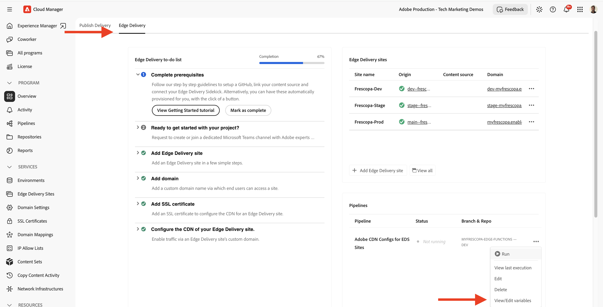
1. Add the following variable, set its type to **Secret**, and apply it to the **Deploy** step:

    | Variable | Value |
    | --- | --- |
    | `FRESCOPA_OIDC_CLIENT_SECRET` | The Google client secret from Step 2 |

    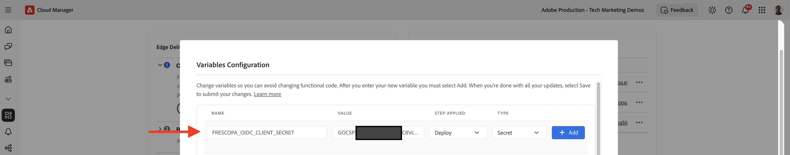

1. Select **Save**.

## Step 4: Configure the CDN OIDC authenticator

Next, you configure the CDN OIDC authenticator by adding it to your `config/cdn.yaml` along with a rule that applies it to the `/members/` path.

```yaml
# config/cdn.yaml
kind: 'CDN'
version: '1'
data:
  ...
  authentication:
    authenticators:
      - type: oidc
        name: frescopa-google-oidc
        clientId: "585724821762-xxxxxxxx.apps.googleusercontent.com"
        clientSecret: ${{FRESCOPA_OIDC_CLIENT_SECRET}}
        authEndpoint: "https://accounts.google.com/o/oauth2/v2/auth"
        tokenEndpoint: "https://oauth2.googleapis.com/token"
        jwksUri: "https://www.googleapis.com/oauth2/v3/certs"
        issuer: "https://accounts.google.com"
        domainMatch: "^dev-myfrescopa\\.enablementadobe\\.com$"
        callback: /callback
        login: /login
        loginTarget: /dev/branches/oidc/members/welcome
        logout: /logout
        logoutTarget: /dev/branches/oidc/signed-out
    rules:
      - name: frescopa-members-rule
        when:
          allOf:
            - { reqProperty: domain, equals: "dev-myfrescopa.enablementadobe.com" }
            - { reqProperty: path, matches: "^(/dev/branches/[^/]+)?/members/.*" }
        action:
          type: authenticate
          authenticator: frescopa-google-oidc
```

| Setting | What it does |
| --- | --- |
| `clientId`, `clientSecret` | Identify the Web application to Google. The secret comes from the pipeline variable, not from Git. |
| `authEndpoint`, `tokenEndpoint`, `jwksUri`, `issuer` | Google OIDC endpoints and issuer from Step 2. |
| `domainMatch` | Regular expression for the domains where the `callback`, `login`, and `logout` endpoints are active. |
| `callback`, `login`, `logout` | CDN paths that finish, start, and end the sign-in. `callback` must equal the redirect URI you registered at Google. |
| `loginTarget` | Where visitors land after login. This tutorial sets it explicitly so every sign-in ends on the Insiders Lounge. |
| `logoutTarget` | Where visitors land after logout. Defaults to the site root. |
| `rules` | Apply the authenticator when the domain and the path match. Anything that does not match stays public. |

>[!NOTE]
>
>Because the pages in this tutorial are served from the `oidc` branch, the `path` regular expression, `loginTarget`, and `logoutTarget` include the `/dev/branches/oidc` prefix. On a production site, use `^/members/.*`, `/members/welcome`, and `/signed-out` instead.

>[!CAUTION]
>
>Always keep the `domain` condition in the rule. Without it, the rule applies to every domain served by the program, including other sites.

If your Git repository already contains a `config/cdn.yaml` (for example, from the [AEM Edge Functions tutorials](../../../cloud-service/edge-functions/setup-eds.md#step-6-review-and-deploy-cdn-configuration)), add the `authentication` block under the existing `data` instead of creating a second file. For example, see [Frescopa's configuration](https://github.com/SachinMali/myfrescopa-edge-functions/blob/dev/config/cdn.yaml) for reference.

Finally, commit the change and push it to the branch that the configuration pipeline's **Source Code** step uses.

## Step 5: Deploy the configuration

Run the configuration pipeline to apply the changes.

1. In Cloud Manager, open the **Edge Delivery** > **Pipelines** section and verify that the configuration pipeline's **Source Code** step points at the branch where you committed `cdn.yaml`.
    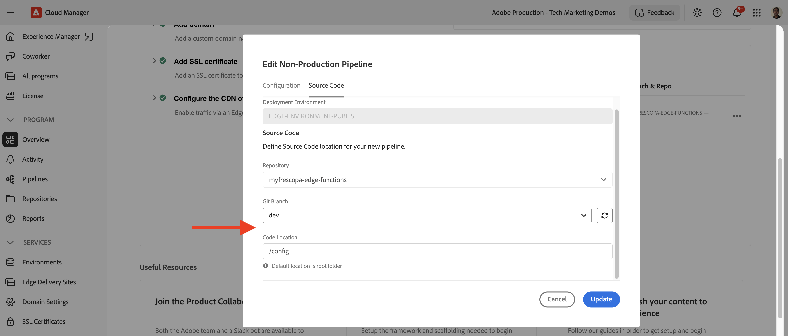

1. Run the configuration pipeline.

    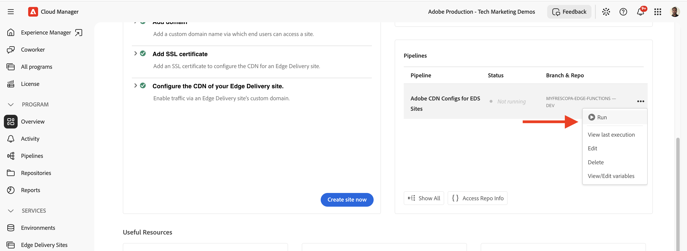

1. Monitor the pipeline until it completes successfully.

    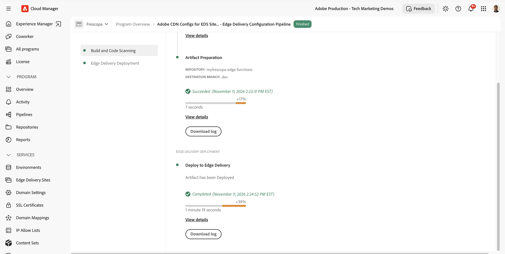

## Step 6: Restrict access to the `.aem.live` origin

The CDN rule protects `dev-myfrescopa.enablementadobe.com`, but the same content is also served from the Edge Delivery Services origin hostname, `https://<branch>--<site>--<org>.aem.live`. Anyone who knows that address can read the protected pages and skip the sign-in.

>[!WARNING]
>
>Authenticating at the CDN alone is not enough. For production sites, restrict access to the `.aem.live` hostname so that the Adobe-managed CDN is the only way to reach your content.

To do so:

1. Enable site authentication for your Edge Delivery Services site. See [Set up site authentication](https://www.aem.live/docs/authentication-setup-site).
1. Configure the Adobe-managed CDN to present the site authentication token on every request to the origin. See _Origin Authentication_ in [Adobe-managed CDN configuration](https://www.aem.live/developer/byo-cdn-adobe-managed-cdn-config#origin-authentication).

This tutorial does not restrict the `.aem.live` hostname, so it can focus on the OIDC flow.

## Step 7: Verify

Verify the sign-in flow in a browser.

1. In your browser, go to the [Frescopa Insiders Lounge](https://dev-myfrescopa.enablementadobe.com/dev/branches/oidc/members/welcome) page. The URL is `https://dev-myfrescopa.enablementadobe.com/dev/branches/oidc/members/welcome`.
1. Confirm that you are redirected to the Google sign-in screen, and sign in with an account that your consent screen allows.

    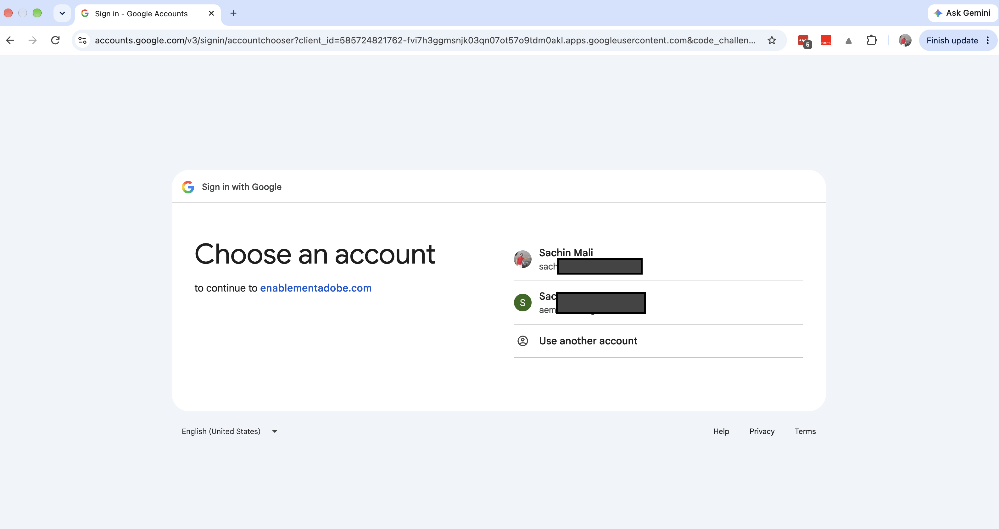
1. Confirm that you land on the Insiders Lounge page and that the `_aem_oidc_session_token` cookie is set (in your browser's developer tools, open **Application** > **Cookies**).

    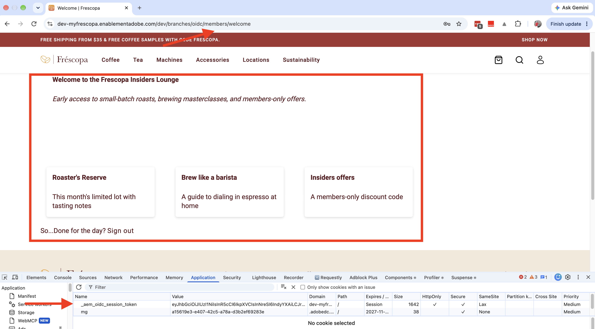
1. On the Insiders Lounge page, select **Sign out** and confirm that you land on the `signed-out` page. Then open the protected page again and confirm that the sign-in is required again.

## Step 8: Show the visitor's name (optional)

The CDN can also return details about the signed-in visitor, so a page can greet them by name. To do that, request the `profile` scope from Google and add an endpoint that returns the identity data the CDN holds for the session.

### Update the CDN configuration

By default, the authenticator asks Google only for the visitor's identity and email address, using the `openid` and `email` scopes. To receive the visitor's name and picture, you also request the `profile` scope, and then add endpoints that return the data.

1. In `config/cdn.yaml`, add `additionalScopes` to the authenticator:

    ```yaml
          - type: oidc
            name: frescopa-google-oidc
            # ...existing settings...
            additionalScopes: [profile]
    ```

1. Add two `respond` rules next to the existing `authenticate` rule, under `authentication.rules`:

    ```yaml
        rules:
          - name: frescopa-members-rule
            # ...existing rule...
          - name: frescopa-respond-with-user-email
            when:
              allOf:
                - { reqProperty: domain, equals: "dev-myfrescopa.enablementadobe.com" }
                - { reqProperty: path, equals: /members/email }
            action:
              type: respond
              status: 200
              body:
                authProperty: oidcUserEmail
          - name: frescopa-respond-with-id-token
            when:
              allOf:
                - { reqProperty: domain, equals: "dev-myfrescopa.enablementadobe.com" }
                - { reqProperty: path, equals: /members/idtoken }
            action:
              type: respond
              status: 200
              body:
                authProperty: oidcIdToken
    ```

| Setting | What it does |
| --- | --- |
| `additionalScopes` | Extra scopes to request from Google, in addition to the default `openid` and `email`. The `profile` scope adds the visitor's name and picture. |
| `type: respond` | The CDN answers the request itself and returns the response defined in the `body` field. |
| `authProperty: oidcUserEmail` | Returns the visitor's email address as plain text. |
| `authProperty: oidcIdToken` | Returns the claims of the visitor's Google ID token as JSON, including `name`, `given_name`, `family_name`, `email`, and `picture`. |

>[!IMPORTANT]
>
>Keep these endpoints under a path that the `authenticate` rule protects, such as `/members/`. On paths outside the protected area, the authenticator does not run and the properties return `(null)`.

Commit the change and run the configuration pipeline again, as in [Step 5](#step-5-deploy-the-configuration). Then **sign out and sign in again**, because your existing session was issued without the `profile` scope.

### Test in the browser

1. Sign in and open the [protected page](https://dev-myfrescopa.enablementadobe.com/dev/branches/oidc/members/welcome).
1. In the browser's developer tools, open the **Console** and run:

    ```js
    fetch('/members/idtoken', { credentials: 'include' })
      .then(r => r.json())
      .then(t => console.log(t.given_name, t.family_name, t.picture));
    ```

1. Confirm that the console prints your first name, last name, and picture URL.

    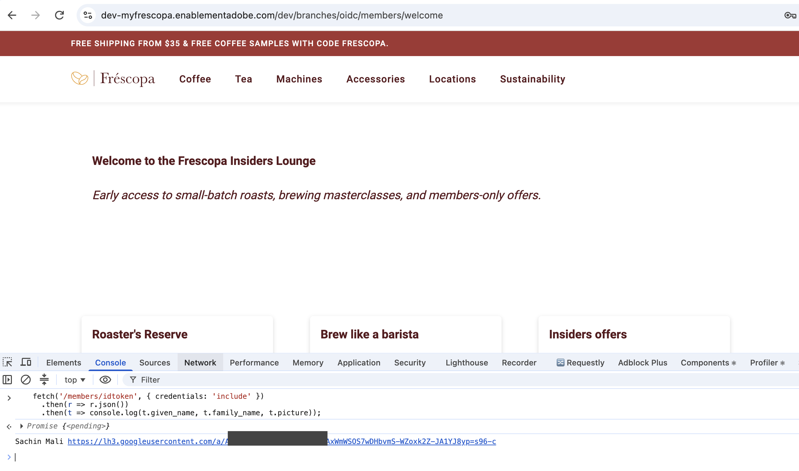

1. To check the email endpoint, run:

    ```js
    fetch('/members/email', { credentials: 'include' })
      .then(r => r.text())
      .then(console.log);
    ```

    It returns plain text, so use `r.text()`, not `r.json()`.

### Show the name in the hero

To see the name on the page, run the following snippet in the browser console while you are on the protected Insiders Lounge page. It adds a greeting at the top of the hero text. It uses `textContent`, so values from the token are never interpreted as HTML.

```js
(async () => {
  const resp = await fetch('/members/idtoken', { credentials: 'include' });
  if (!resp.ok) return;

  const { given_name: givenName } = await resp.json();
  const greeting = document.createElement('p');
  greeting.textContent = `Welcome back, ${givenName}!`;
  document.querySelector('main .hero > div:last-child > div').prepend(greeting);
})();
```

Confirm that _Welcome back, &lt;your first name&gt;!_ appears in the hero. The change is temporary and disappears when you reload the page.

>[!TIP]
>
>This console snippet only demonstrates the data flow. To make the greeting a permanent part of the site, create a dedicated block, for example `greeting`, that fetches `/members/idtoken` in its `decorate` function and renders the name. Authors can then place it on any protected page.

>[!NOTE]
>
>The `/members/idtoken` and `/members/email` endpoints return personal data about the signed-in visitor, so keep them under the protected path. Request only the scopes you need.

## Troubleshooting

| Symptom | Likely cause |
| --- | --- |
| Google shows `redirect_uri_mismatch` | The authorized redirect URI at Google differs from `https://<domain>/callback`. |
| The protected page loads without a sign-in | The pipeline did not finish, the rule `domain` or `path` condition does not match (for example, a branch prefix such as `/dev/branches/oidc` is missing from the regular expression), or you opened the `.aem.live` hostname (see Step 6). |
| Every page, not only `/members/`, asks for sign-in | The rule `path` regular expression is too broad. |
| Sign-in loops after returning from Google | The `callback` path does not match the registered redirect URI, or `issuer` or `jwksUri` is wrong. |
| After sign-in, you land on the `signed-out` page or the wrong page | Check `loginTarget` and `logoutTarget` in the authenticator configuration. |
| `/members/email` or `/members/idtoken` returns `(null)` | The endpoint path is not covered by the `authenticate` rule, or the session was created before you added `additionalScopes`. Keep the path under `/members/`, then sign out and sign in again. |
| `given_name` and `family_name` are missing | `additionalScopes: [profile]` is not deployed yet, or you did not sign in again after deploying it. |
| The pipeline fails on `${{...}}` | The variable name differs from the one in the YAML, or it is not applied to the **Deploy** step. |

## Summary

You protected a `/members/` section of the Frescopa Edge Delivery Services site with Google sign-in, enforced at the Adobe-managed CDN. You limited who can sign in at Google, kept the client secret out of Git, and learned why to restrict access to the `.aem.live` origin. Optionally, you also returned the visitor's name and email from the CDN to greet them in a page.

## Additional resources

- [Adobe-managed CDN configuration: CDN OIDC authentication](https://www.aem.live/developer/byo-cdn-adobe-managed-cdn-config#cdn-oidc-authentication)
- [Edge Delivery configuration pipeline](../developing/cloud-manager-configuration-pipeline.md)
- [Use configs and secrets with Edge Functions](../../../cloud-service/edge-functions/how-to/configs-and-secrets.md)
- [Set up site authentication](https://www.aem.live/docs/authentication-setup-site)
- [Configuring CDN credentials and authentication](https://experienceleague.adobe.com/en/docs/experience-manager-cloud-service/content/implementing/content-delivery/cdn-credentials-authentication)
- [Google OpenID Connect documentation](https://developers.google.com/identity/openid-connect/openid-connect)
